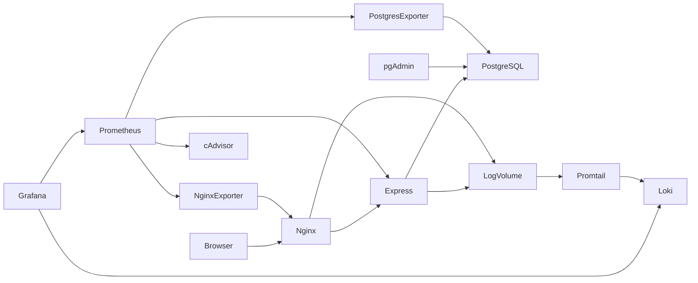

# Đề 14 — Hệ thống Quản lý Dự án

Express + PostgreSQL + pgAdmin + Nginx. Giao diện tiếng Việt hỗ trợ tạo dự án, thành viên, task, phân công và cập nhật trạng thái Kanban. Dữ liệu lưu trong PostgreSQL, không lưu trong trình duyệt.

**Trạng thái:** đã chạy Docker Compose và kiểm tra tích hợp ngày 20/10/2026. Smoke test đạt, Prometheus có 5 target UP, pgAdmin HTTP 200, có metrics từng container và kết quả 3 truy vấn Loki. Xem [kết quả kiểm chứng](docs/VERIFICATION.md). Báo cáo và thông tin sinh viên để làm sau theo yêu cầu.

## Khởi chạy trên Windows

Yêu cầu Docker Desktop chạy Linux containers, Docker Compose v2, PowerShell và khoảng 6 GB RAM trống. Mở terminal tại thư mục repository:

```powershell
powershell -ExecutionPolicy Bypass -File scripts/init.ps1
docker compose up -d --build
docker compose ps
```

Script tạo `.env` bằng bộ sinh số ngẫu nhiên mật mã. Xem mật khẩu cục bộ trong `.env`, không đưa vào GitHub hoặc ảnh demo. Không chạy lại script trên DB đã khởi tạo. Thay `.env` không tự đổi mật khẩu trong PostgreSQL volume.

| Thành phần | Địa chỉ | Đăng nhập |
|---|---|---|
| Website qua Nginx | http://localhost:8080 | Bản lab không có đăng nhập |
| pgAdmin | http://localhost:5050 | PGADMIN_EMAIL / PGADMIN_PASSWORD trong .env |
| Grafana | http://localhost:3000 | admin / GRAFANA_PASSWORD trong .env |
| Prometheus | http://localhost:9090 | Chỉ localhost |

Trong pgAdmin chọn Register > Server: Name `Project DB`; Host `db`; Port `5432`; Maintenance database `projects`; Username `project_app`; Password `APP_DB_PASSWORD`. Không dùng localhost vì pgAdmin chạy trong container riêng. Dùng tài khoản `postgres` chỉ khi cần quản trị.

## Kiến trúc



Nginx là cổng vào website. Network `data` cô lập DB, `web` nối proxy và app, `monitoring` dành cho quan sát. Chỉ các giao diện demo được bind vào loopback host. DB, exporter, Loki không mở port host.

Grafana tự nạp datasource Prometheus và dashboard `Project Management — Containers Web Database`. Prometheus có 5 job: chính nó, app, Nginx exporter, PostgreSQL exporter và cAdvisor. Chờ 30–60 giây, tạo vài request rồi chờ ít nhất 2 phút để rate có đủ mẫu. cAdvisor cần đọc thông tin Docker host; đây là ngoại lệ quyền của bộ giám sát, không áp dụng cho app. Mount `/var/run` bao gồm Docker socket: dù mount read-only, Docker API vẫn có quyền cao. Không cho người dùng không tin cậy truy cập cAdvisor. Trên Docker Desktop metrics là của Linux VM, không phải toàn bộ Windows. Một số máy dùng cgroup/storage khác có thể cần điều chỉnh cAdvisor; kiểm tra có series `container_*{image!=""}` thay vì chỉ nhìn target UP.

Loki được provision sẵn trong Grafana Explore. Promtail đọc log app/Nginx từ volume chia sẻ, không dùng Docker socket. Có 4 truy vấn LogQL và hướng dẫn tạo dữ liệu tại [docs/DEMO.md](docs/DEMO.md). Promtail đã hết hỗ trợ 02/03/2026; giữ trong lab theo đề, chuyển sang Alloy trước khi dùng thực tế. Nguồn chính thức: https://grafana.com/docs/loki/latest/send-data/promtail/.

## Bảo mật và giới hạn

- App dùng user `node`, Nginx dùng image unprivileged. Root filesystem app và proxy read-only, `/tmp` dùng tmpfs.
- Drop capabilities và `no-new-privileges`. PostgreSQL cần một số quyền khởi tạo/chuyển user; tiến trình DB chạy dưới user postgres theo entrypoint chính thức. `log-init` chạy root một lần để cấp quyền hai thư mục log, không có mạng.
- Role `project_app` chỉ thao tác dữ liệu; không có quyền tạo bảng, superuser hoặc pg_monitor. Role giám sát riêng có pg_monitor.
- SQL dùng tham số, kiểm tra input, giới hạn request 32 KB. Giao diện dùng textContent để tránh chèn HTML.
- Nginx đặt CSP, X-Frame-Options, X-Content-Type-Options, Referrer-Policy và Permissions-Policy. Đề cho phép headers thay HTTPS; bản này dùng HTTP cục bộ, không đặt HSTS khi chưa có TLS.
- Đây là lab localhost, API chưa xác thực/phân quyền người dùng. Không đưa ra Internet trước khi bổ sung đăng nhập, phân quyền, TLS, rate limit và sao lưu.
- Log file chia sẻ cần chính sách xoay vòng khi chạy dài ngày; Docker stdout đã giới hạn 3 × 10 MB mỗi service.

## API

`GET /health`, `GET /api/data`, `POST /api/projects` (name,description), `POST /api/members` (name,email), `POST /api/tasks` (title,project_id,member_id), `PATCH /api/tasks/:id` (status: todo/doing/done). `/metrics` chỉ dùng nội bộ và bị Nginx chặn.

## Kiểm chứng và demo

```powershell
powershell -ExecutionPolicy Bypass -File scripts/smoke.ps1
docker compose exec app id
docker compose exec nginx id
docker compose exec db psql -U postgres -d projects -c '\du'
docker compose ps
```

Tạo dự án, thành viên, task trên web; đổi trạng thái; refresh trang để chứng minh lưu DB. Mở pgAdmin xem ba bảng. Thực hiện hướng dẫn giám sát/log ở `docs/DEMO.md`. Chụp ảnh thực tế vào `evidence/` (đã ignore), che mật khẩu. Không dùng ảnh mẫu làm bằng chứng đã chạy.

## Dừng và sao lưu

`docker compose down` giữ dữ liệu. `docker compose down -v` xóa vĩnh viễn toàn bộ dữ liệu lab, chỉ dùng khi chủ động muốn khởi tạo lại.

Sao lưu không đi qua chuyển đổi encoding của PowerShell:

```powershell
docker compose exec db sh -c 'pg_dump -U postgres -d projects -Fc -f /tmp/projects.dump'
docker compose cp db:/tmp/projects.dump ./projects.dump
```

Giữ bản backup ngoài repo và kiểm tra khôi phục trên DB thử nghiệm trước khi dựa vào backup.

## GitHub

Tạo tài khoản và repository theo mã số sinh viên của chính bạn trên GitHub. Chưa có mã SV và thông tin tài khoản nên chưa tạo remote/push. Ba giai đoạn commit: (1) app + DB + pgAdmin + Nginx; (2) Prometheus + Grafana + exporters; (3) Loki + Promtail + LogQL. Xem `git log --oneline`.

```powershell
git remote add origin https://github.com/<MSSV>/<MSSV>-project-management.git
git branch -M main
git push -u origin main
```

Không commit `.env`, dump DB hoặc screenshot lộ thông tin. Báo cáo sinh viên thực hiện sau theo yêu cầu hiện tại.
